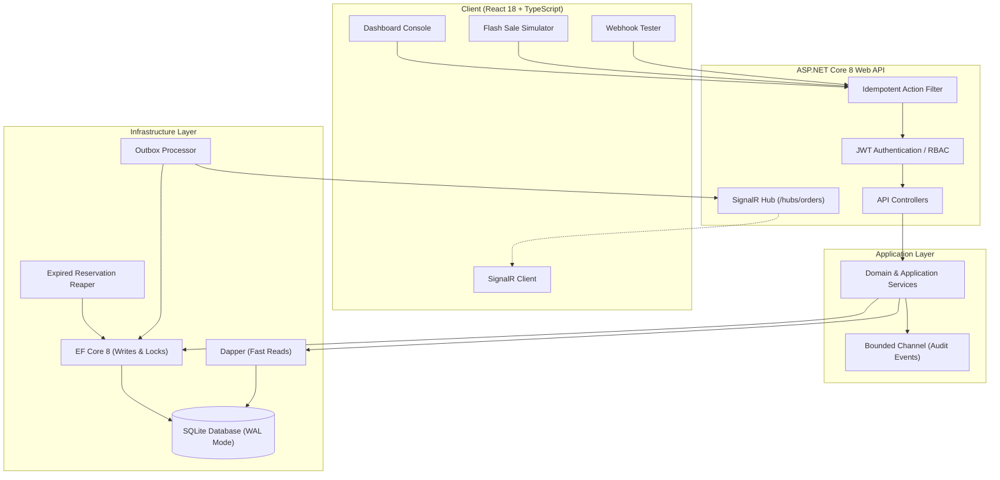

# OmniOrder

High-Concurrency Distributed Order Management, Inventory Locking, and Payment Webhook Engine built with .NET 8 (C# 12) and React 18 / TypeScript.

---

## Overview

OmniOrder is an order management and inventory reservation engine designed to handle high-concurrency e-commerce scenarios, such as flash sales. It prevents overselling through optimistic concurrency control, ensures reliable payment processing via idempotent webhooks, and provides real-time telemetry over WebSockets.

---

## Key Features

- **Optimistic Concurrency Control:** Prevents overselling during concurrent checkout spikes using database-level concurrency tokens on product records.
- **Flash Sale Simulation:** Built-in simulation endpoint that executes 50 parallel order requests against limited inventory (5 items), demonstrating that exactly 5 succeed and 45 fail gracefully with HTTP 409 Conflict.
- **Idempotent Payment Webhooks:** Validates incoming webhook requests with HMAC-SHA256 signatures and guarantees exactly-once processing even when duplicate webhooks are delivered.
- **Transactional Outbox Pattern:** Guarantees database state changes and downstream event publishing occur atomically.
- **Asynchronous Channels & Background Workers:** Uses bounded System.Threading.Channels for decoupled audit logging, a background worker for auto-releasing expired reservations (5-minute TTL), and an outbox processor broadcasting order events.
- **Dual ORM Architecture:** Uses EF Core 8 for ACID transactional writes and Dapper with raw parameterized SQL for fast analytical reads.
- **Security & Standards:** JWT Bearer authentication with Role-Based Access Control (Admin and Customer roles) and RFC 7807 ProblemDetails for error responses.
- **Real-Time Operational Dashboard:** React 18 single-page application connecting to SignalR for live inventory updates, order streams, and interactive race condition simulation.

---

## System Architecture



---

## Technology Stack

- **Backend:** .NET 8, C# 12, ASP.NET Core Web API
- **Data Access:** Entity Framework Core 8, Dapper
- **Database:** SQLite with Write-Ahead Logging (WAL mode), with support for PostgreSQL and MS SQL Server
- **Messaging & Concurrency:** System.Threading.Channels, Microsoft.AspNetCore.SignalR
- **Security:** HMAC-SHA256, JWT (JSON Web Tokens)
- **Frontend:** React 18, TypeScript, Vite, Tailwind CSS, Lucide React
- **Testing:** xUnit, Microsoft.AspNetCore.Mvc.Testing, FluentAssertions

---

## Project Structure

```text
omniorder/
├── OmniOrder.slnx                   # .NET 8 solution
├── docker-compose.yml               # Container orchestration
├── Dockerfile                       # Multi-stage container build
├── README.md                        # Project documentation
├── gemini.md                        # Technical audit and changelog
├── src/
│   ├── OmniOrder.Domain/            # Entities, Enums, Domain Exceptions
│   ├── OmniOrder.Application/       # DTOs, Service Interfaces, Channel Events
│   ├── OmniOrder.Infrastructure/    # DbContext, Dapper Queries, Background Workers
│   └── OmniOrder.Api/               # Controllers, Middlewares, SignalR Hub
├── tests/
│   └── OmniOrder.IntegrationTests/  # Concurrency and idempotency integration tests
└── client/                          # React + TypeScript frontend dashboard
```

---

## REST API Reference

| Method | Endpoint | Description | Headers |
| :--- | :--- | :--- | :--- |
| POST | `/api/v1/auth/demo-token` | Generates a demo JWT token | None |
| GET | `/api/v1/products` | Lists all products and current stock | None |
| GET | `/api/v1/orders` | Lists order history | None |
| POST | `/api/v1/orders` | Creates an order with stock reservation | `X-Idempotency-Key: <key>` |
| POST | `/api/v1/simulator/flash-sale` | Runs 50 parallel order requests | None |
| POST | `/api/v1/webhooks/payment` | Receives and verifies payment webhooks | `X-Signature: <hmac>`, `X-Idempotency-Key: <key>` |
| POST | `/api/v1/webhooks/generate-signature` | Generates HMAC-SHA256 signature for testing | None |
| GET | `/api/v1/analytics/dashboard-metrics` | Returns analytics with EF Core vs Dapper latency | None |
| WS | `/hubs/orders` | Real-time SignalR WebSocket order stream | None |

---

## How to Run Locally

### Prerequisites
- .NET 8 SDK
- Node.js (v18 or higher) and npm

---

### Step 1: Start the Backend API

Open a terminal in the project root:

```powershell
dotnet run --project src/OmniOrder.Api
```

- API Base URL: `http://localhost:5000`
- Swagger Documentation: `http://localhost:5000/swagger`
- SignalR WebSocket Hub: `http://localhost:5000/hubs/orders`

On first run, SQLite is initialized in WAL mode and automatically seeded with 8 products and sample orders.

---

### Step 2: Start the Frontend Dashboard

Open a second terminal in the project root:

```powershell
cd client
npm install
npm run dev
```

- Frontend URL: `http://localhost:5173`

The Vite development server proxies API requests directly to the backend at `http://localhost:5000`.

---

## Running Integration Tests

The test suite tests race condition concurrency, idempotency, webhook deduplication, and ORM latency:

```powershell
dotnet test
```

### Verified Test Cases:
1. **FlashSaleSimulation_50ConcurrentRequests_OnlyAvailableStockPurchased:** Verifies 50 concurrent buyers targeting 5 items yields exactly 5 successes and 45 rejections (HTTP 409).
2. **CreateOrder_WithSameIdempotencyKey_ReturnsSameResponse:** Verifies duplicate requests with identical idempotency keys return the cached response.
3. **PaymentWebhook_DuplicateEventFired5Times_ProcessedExactlyOnce:** Verifies replaying the same webhook 5 times processes state transitions only once.
4. **GetDashboardMetrics_ReturnsValidDualOrmMetrics:** Verifies dual ORM execution and latency benchmarking.
5. **GetDemoToken_ReturnsValidJwt:** Verifies token generation with role claims.

---

## Docker Deployment

To build and run the backend using Docker:

```bash
docker compose up --build
```

---

## License

This project is licensed under the MIT License.