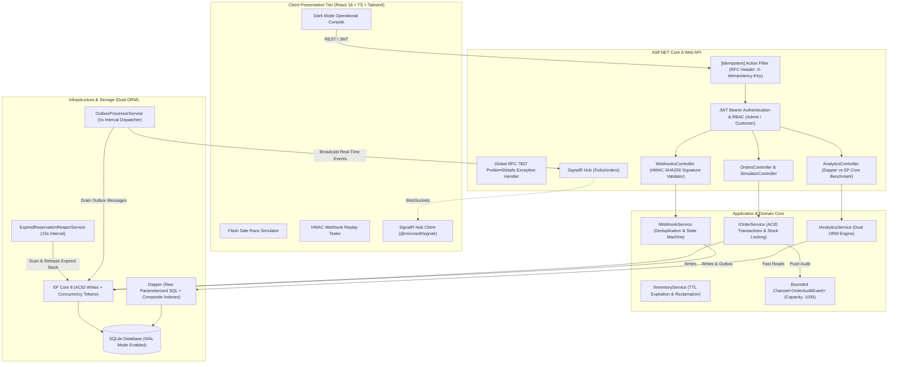
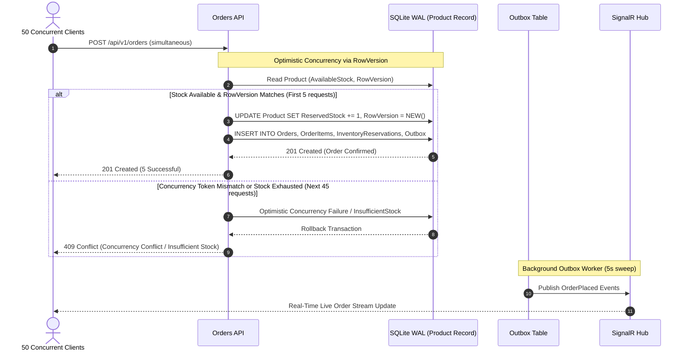

# 🚀 OmniOrder — High-Concurrency Distributed Order Management & Payment Webhook Engine

[](https://dotnet.microsoft.com/)
[](https://learn.microsoft.com/en-us/dotnet/csharp/)
[](https://react.dev/)
[](https://www.typescriptlang.org/)
[](https://vitejs.dev/)
[](https://tailwindcss.com/)
[](https://sqlite.org/)
[](https://github.com/DapperLib/Dapper)
[](https://dotnet.microsoft.com/apps/aspnet/signalr)
[](https://opensource.org/licenses/MIT)

**OmniOrder** is an enterprise-grade, high-concurrency Distributed Order Management, Inventory Locking, and Payment Webhook engine built from the ground up with **.NET 8 (C# 12)** and **React 18 / TypeScript**. It demonstrates the architectural patterns required by Tier-1 distributed commerce platforms: **Optimistic Concurrency Control (Anti-Overselling Engine)**, **Distributed Idempotency**, **Transactional Outbox**, **System.Threading.Channels Asynchronous Ingestion**, **Dual ORM Strategy (EF Core 8 Writes + Dapper Reads)**, and **SignalR Real-Time Telemetry**.

---

## 🏛 System Architecture

OmniOrder adheres strictly to **Clean Architecture** and **Domain-Driven Design (DDD)** principles, separating core domain models, business use-cases, persistence infrastructure, and presentation APIs into decoupled modules.



---

## ⚡ Concurrency & State Machine Flow

### 1. Flash-Sale Anti-Overselling Engine (Optimistic Concurrency)
When 50 buyers race for the final 5 units of stock simultaneously:
1. Each request begins an explicit transaction and checks `AvailableStock = TotalStock - ReservedStock >= RequestedQuantity`.
2. EF Core inspects the `RowVersion` concurrency token.
3. The first 5 requests acquire locks, increment `ReservedStock`, rotate the `RowVersion`, and commit.
4. The remaining 45 requests hit either a **`DbUpdateConcurrencyException`** or **`InsufficientStockException`**, catching the conflict gracefully and returning an HTTP **409 Conflict**.
5. **Result:** Exactly 5 units sold, 0 oversold, 0 negative stock.



---

## 🎯 6 Enterprise Features Implemented

### 1. Optimistic Concurrency Inventory Reservation (Anti-Overselling Engine)
- **Entities:** `Product` (`TotalStock`, `ReservedStock`, computed `AvailableStock`), `Order`, `OrderItem`, `InventoryReservation`.
- **Token Mechanism:** Configured via `IsConcurrencyToken()` on a 16-byte cryptographically random token rotated automatically inside `OmniOrderDbContext.SaveChangesAsync()`.
- **Built-in Simulator (`POST /api/v1/simulator/flash-sale`):** Spawns 50 parallel asynchronous `Task` threads attempting to purchase the last 5 units of an item. Verifies that **5 succeed (201 Created)** and **45 fail (409 Conflict)**.

### 2. Idempotent Payment Webhook Engine & Transactional Outbox
- **Idempotency Action Filter (`[Idempotent]`):** Enforces an `X-Idempotency-Key` header on mutating POST operations. Caches results using SHA-256 request payload hashing. Duplicate submissions return the cached payload with an `X-Cache: HIT` header.
- **HMAC-SHA256 Signature Verification:** Validates incoming payloads (`PAYMENT_CAPTURED`, `PAYMENT_FAILED`) against an HMAC secret.
- **State Machine Transitions:**
  - `PAYMENT_CAPTURED`: Transitions order from `Pending` $\to$ `Paid`, finalizes `ReservedStock` into confirmed sale.
  - `PAYMENT_FAILED`: Transitions order from `Pending` $\to$ `Cancelled`, instantly releases reserved stock back to available stock.
- **Deduplication:** Repeated firings of the same webhook event ID are detected via `WebhookEventLogs` and deduplicated safely.

### 3. High-Throughput Asynchronous Processing (Channels & Background Workers)
- **`OrderAuditChannel`:** In-memory, bounded `System.Threading.Channels.Channel<OrderAuditEvent>` (1,000 capacity) for high-throughput, non-blocking ingestion of audit events.
- **`ExpiredReservationReaperService`:** Background worker that runs every 15 seconds. Identifies `Pending` reservations past their 5-minute TTL, releases `ReservedStock`, marks reservations `Expired`, and cancels abandoned orders.
- **`OutboxProcessorService`:** Relentlessly polls the `OutboxMessages` table every 5 seconds, publishes events via SignalR, and flags messages as processed.

### 4. Dual ORM Strategy (EF Core 8 Writes + Dapper Reads)
- **EF Core 8:** Governs all transactional writes, entity relationships, identity tracking, and concurrency enforcement.
- **Dapper:** Powering `GET /api/v1/analytics/dashboard-metrics` with raw, parameterized SQL queries for instant analytics reads (Total GMV, Order Velocity, Lock Contention Rate, and a live side-by-side execution latency benchmark comparing EF Core vs Dapper).

### 5. Enterprise Security & Observability
- **JWT Authentication & RBAC:** Pre-configured `Admin` and `Customer` roles. Includes `POST /api/v1/auth/demo-token` for instant token generation in Swagger and UI.
- **RFC 7807 Global Exception Handling:** `GlobalExceptionHandler` converts all unhandled domain and validation exceptions into standardized `ProblemDetails` format (400, 404, 409, 422, 500).
- **Swagger / OpenAPI:** Integrated with JWT Bearer authentication scheme.

### 6. Zero-Config Database Seeding
- On application boot, migrations and schema creation execute automatically.
- Seeds 8 realistic tech hardware products (including a "Flash Sale RTX 4090" with 5 units left) and historical orders so the dashboard is immediately operational.

---

## 🛠 Technology Stack & ATS Keywords

- **Languages & Frameworks:** C# 12, .NET 8 (LTS), ASP.NET Core Web API, TypeScript 5.5, React 18, Vite.
- **Architecture & Patterns:** Clean Architecture, Domain-Driven Design (DDD), CQRS, Repository Pattern, Optimistic Concurrency Control, Transactional Outbox Pattern, At-Least-Once Delivery, Idempotent Consumer, Producer-Consumer Channel Pattern.
- **Data & ORM:** Entity Framework Core 8, Dapper, SQLite (Write-Ahead Logging / WAL mode), SQL Server / PostgreSQL compatibility, Raw SQL, Index Optimization.
- **Messaging & Real-Time:** System.Threading.Channels, Microsoft.AspNetCore.SignalR, BackgroundService, IHostedService.
- **Security & Standards:** HMAC-SHA256, JWT (JSON Web Tokens), Role-Based Access Control (RBAC), RFC 7807 ProblemDetails, Action Filters.
- **Frontend & Styling:** Tailwind CSS, Lucide React, Axios, @microsoft/signalr, Responsive Dark-Mode UI.
- **Testing & Tooling:** xUnit, Microsoft.AspNetCore.Mvc.Testing, FluentAssertions, Docker, Docker Compose.

---

## 📂 Project Directory Structure

```text
omniorder/
├── OmniOrder.slnx                         # Multi-project .NET 8 solution
├── docker-compose.yml                     # Docker orchestration (SQLite, optional Postgres/MSSQL)
├── Dockerfile                             # Multi-stage production build
├── README.md                              # System documentation
├── gemini.md                              # Detailed changelog and execution audit
├── src/
│   ├── OmniOrder.Domain/                  # Pure enterprise domain models
│   │   ├── Entities/                      # Product, Order, OrderItem, InventoryReservation, etc.
│   │   ├── Enums/                         # OrderStatus, ReservationStatus, WebhookStatus
│   │   └── Exceptions/                    # DomainException, InsufficientStockException, etc.
│   ├── OmniOrder.Application/             # Business logic layer
│   │   ├── DTOs/                          # Request & response contracts
│   │   ├── Interfaces/                    # Service and repository contracts
│   │   └── Events/                        # OrderAuditEvent
│   ├── OmniOrder.Infrastructure/          # Data persistence and workers
│   │   ├── Data/                          # OmniOrderDbContext, DatabaseSeeder
│   │   ├── Services/                      # OrderService, WebhookService, AnalyticsService, etc.
│   │   ├── Channels/                      # OrderAuditChannel (Bounded Channel)
│   │   └── BackgroundWorkers/             # ExpiredReservationReaperService, OutboxProcessorService
│   └── OmniOrder.Api/                     # HTTP and presentation tier
│       ├── Controllers/                   # Orders, Webhooks, Simulator, Analytics, Auth
│       ├── Middleware/                    # GlobalExceptionHandler, IdempotentAttribute
│       └── Program.cs                     # Composition root, DI, CORS, SignalR, Swagger
├── tests/
│   └── OmniOrder.IntegrationTests/        # xUnit concurrency and idempotency tests
│       └── UnitTest1.cs                   # 5 passing concurrency, webhook, and latency tests
└── client/                                # React 18 + Vite + Tailwind CSS console
    ├── src/
    │   ├── components/                    # Header, Simulator, WebhookTester, InventoryTable, Stream
    │   ├── api.ts                         # Axios client with demo auth injection
    │   ├── useSignalR.ts                  # Real-time WebSocket hook
    │   ├── types.ts                       # Shared TypeScript models
    │   └── App.tsx                        # Main dark-mode dashboard
    └── package.json
```

---

## 📡 REST API Reference

| Method | Endpoint | Description | Auth / Headers |
| :--- | :--- | :--- | :--- |
| `POST` | `/api/v1/auth/demo-token` | Generates a JWT token for testing | None |
| `GET` | `/api/v1/products` | Retrieves all products with stock info | None |
| `GET` | `/api/v1/orders` | Retrieves order history with reservations | None |
| `POST` | `/api/v1/orders` | Creates an order with stock lock | `X-Idempotency-Key: <key>` |
| `POST` | `/api/v1/simulator/flash-sale` | Spawns 50 parallel concurrent order attempts | None |
| `POST` | `/api/v1/webhooks/payment` | Ingests signed payment webhooks | `X-Signature: <hmac>`, `X-Idempotency-Key: <key>` |
| `POST` | `/api/v1/webhooks/generate-signature` | Computes HMAC-SHA256 signature for testing | None |
| `GET` | `/api/v1/analytics/dashboard-metrics` | High-speed Dapper analytics + benchmark | None |
| `WS` | `/hubs/orders` | Real-time SignalR order broadcast stream | WebSocket |

---

## 🚀 How to Run Locally

### Prerequisites
- [.NET 8 SDK](https://dotnet.microsoft.com/download/dotnet/8.0)
- [Node.js (v18+) & npm](https://nodejs.org/)

---

### Step 1: Start the .NET 8 Backend API
Open a terminal in the project root:
```powershell
dotnet run --project src/OmniOrder.Api
```
- **API URL:** `http://localhost:5000`
- **Swagger UI:** `http://localhost:5000/swagger`
- **SignalR Hub:** `http://localhost:5000/hubs/orders`

*On first startup, the database is automatically created in SQLite WAL mode and pre-seeded with 8 products and historical orders.*

---

### Step 2: Start the React 18 Operational Dashboard
Open a second terminal window in the project root:
```powershell
cd client
npm install   # (only required on first run)
npm run dev
```
- **Dashboard URL:** `http://localhost:5173` *(configured with Vite reverse proxy pointing directly to the backend at `http://localhost:5000`)*

---

## 🧪 Running Integration Tests

Run the full xUnit test suite verifying high-concurrency race conditions, idempotency, and webhook replay protection:

```bash
dotnet test
```

### Test Suite Coverage:
- `FlashSaleSimulation_50ConcurrentRequests_OnlyAvailableStockPurchased`: Confirms that out of 50 concurrent requests, exactly 5 units succeed and 45 return HTTP 409.
- `CreateOrder_WithSameIdempotencyKey_ReturnsSameResponse`: Verifies `X-Idempotency-Key` response caching.
- `PaymentWebhook_DuplicateEventFired5Times_ProcessedExactlyOnce`: Confirms HMAC verification and duplicate replay rejection.
- `GetDashboardMetrics_ReturnsValidDualOrmMetrics`: Benchmarks EF Core vs Dapper query execution.
- `GetDemoToken_ReturnsValidJwt`: Validates JWT creation and claim structure.

---

## 🐳 Docker Deployment

To run the entire system in isolated containers:
```bash
docker compose up --build
```
This builds and launches the ASP.NET Core API with volume-mounted SQLite storage. Instructions to switch to PostgreSQL or MS SQL Server are provided in comments inside `docker-compose.yml` and `appsettings.json`.

---

## 📜 License
This project is open-source under the [MIT License](LICENSE).
# OmniOrder

